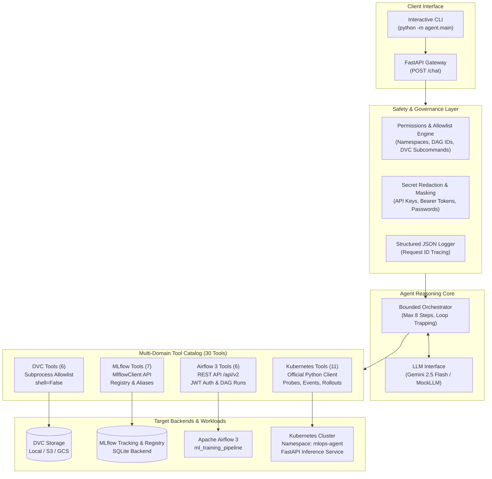
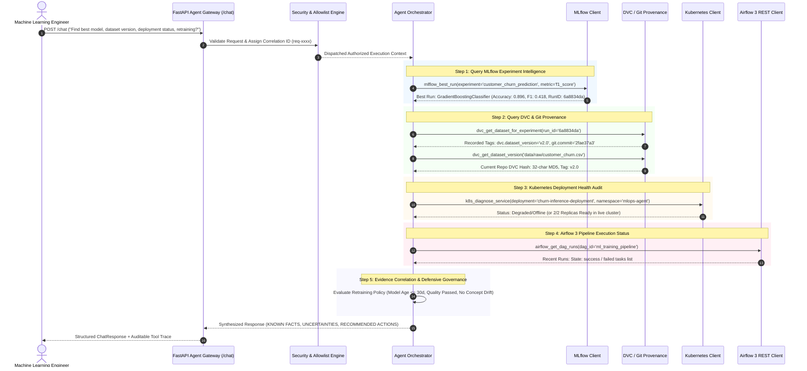

# MLOps AI Platform Agent - Architecture & Design Specifications

**Course:** MLOps & Production AI Engineering (Assignment 03, Fall 2026)  
**Student:** Hassaan Mudassar  
**Roll No:** i230536  
**Section:** CS-A  

---

## 1. System Architecture Overview

The system implements an autonomous, evidence-driven MLOps AI Platform Agent. The agent interprets natural language operational requests, dynamically selects and executes specialized tools across four foundational MLOps domains (DVC, MLflow, Apache Airflow 3, and Kubernetes), enforces strict non-negotiable safety guardrails, and correlates verified evidence into auditable responses.

---

## 2. End-to-End Execution Sequence Diagram

The diagram below illustrates the complete sequence for the mandatory multi-tool reasoning query:
*"Find the best recent model, identify the dataset version used to train it, check the deployment status, and explain whether retraining is necessary."*

---

## 3. Tool Catalog and Security Permissions Table

Every operational action is categorized by capability domain, mutating status, and required security safeguards:

| Tool Name | Domain | Action Type | Confirmation Required? | Allowed Targets / Policy |
| :--- | :--- | :---: | :---: | :--- |
| `dvc_list_tracked_datasets` | DVC | Read-Only | No | Local `.dvc` files |
| `dvc_get_dataset_version` | DVC | Read-Only | No | Dataset pointer files |
| `dvc_compare_versions` | DVC | Read-Only | No | Any two valid git revisions/tags |
| `dvc_detect_changes` | DVC | Read-Only | No | Subprocess allowlist (`status`) |
| `dvc_explain_reproduce` | DVC | Read-Only | No | Deterministic checkout instructions |
| `dvc_get_dataset_for_experiment` | DVC / MLflow | Read-Only | No | Recorded MLflow tags |
| `mlflow_list_experiments` | MLflow | Read-Only | No | Tracking backend store |
| `mlflow_list_runs` | MLflow | Read-Only | No | Active experiments |
| `mlflow_get_run_details` | MLflow | Read-Only | No | Valid run IDs |
| `mlflow_best_run` | MLflow | Read-Only | No | Metric optimization & overfitting audit |
| `mlflow_compare_runs` | MLflow | Read-Only | No | Side-by-side run comparison |
| `mlflow_compare_experiments` | MLflow | Read-Only | No | Experiment statistics |
| `mlflow_get_registry_info` | MLflow | Read-Only | No | Registered models & aliases |
| `airflow_list_dags` | Airflow 3 | Read-Only | No | Airflow REST API `/api/v2/dags` |
| `airflow_get_dag_runs` | Airflow 3 | Read-Only | No | Valid DAG IDs |
| `airflow_trigger_dag` | Airflow 3 | **Mutating** | **Yes (`confirm=True`)** | **`ml_training_pipeline` only** |
| `airflow_get_failed_tasks` | Airflow 3 | Read-Only | No | Airflow task instances |
| `airflow_get_task_instances` | Airflow 3 | Read-Only | No | Airflow task instances |
| `airflow_get_task_logs` | Airflow 3 | Read-Only | No | Logs with automatic secret redaction |
| `k8s_list_pods` | Kubernetes | Read-Only | No | Approved namespace (`mlops-agent`, `default`) |
| `k8s_list_deployments` | Kubernetes | Read-Only | No | Approved namespaces |
| `k8s_get_pod_status` | Kubernetes | Read-Only | No | Namespace scoped |
| `k8s_get_pod_logs` | Kubernetes | Read-Only | No | Tail N lines with secret redaction |
| `k8s_list_services` | Kubernetes | Read-Only | No | Approved namespaces |
| `k8s_get_events` | Kubernetes | Read-Only | No | Approved namespaces |
| `k8s_find_unhealthy_pods` | Kubernetes | Read-Only | No | CrashLoopBackOff, ImagePullBackOff audit |
| `k8s_get_deployed_version` | Kubernetes | Read-Only | No | Deployment image tag & labels |
| `k8s_diagnose_service` | Kubernetes | Read-Only | No | Multi-resource aggregated diagnosis |
| `k8s_restart_deployment` | Kubernetes | **Mutating** | **Yes (`confirm=True`)** | **Allowed namespace (`mlops-agent`, `default`)** |
| `k8s_scale_deployment` | Kubernetes | **Mutating** | **Yes (`confirm=True`)** | **Allowed namespace & 0-10 replica limit** |

---

## 4. Architectural Design Justifications

### 4.1 Direct Tool-Calling vs. Retrieval-Augmented Generation (RAG)
- **Problem with RAG:** RAG retrieves static text chunks from documentation or historical snapshots. Operational infrastructure changes every second (e.g., pods restart, models are registered, pipeline runs succeed or fail). Relying on RAG guarantees stale answers and operational hallucinations.
- **Why Tool-Calling:** Direct function/tool calling executes deterministic, real-time queries against live APIs (MLflow Tracking, Git/DVC, Kubernetes API, Airflow 3 REST). The LLM receives structured JSON outputs and synthesizes facts solely from live evidence.

### 4.2 Subprocess Allowlist & Shell Security (`shell=False`)
- All DVC and Git subprocess executions use `shell=False` and pass arguments as structured arrays (`List[str]`), completely preventing shell-injection attacks (`&&`, `;`, `|`).
- A strict subcommand allowlist (`status`, `diff`, `list`, `checkout`, `pull`) rejects arbitrary system commands before execution.

### 4.3 Official Client SDKs vs. UI Scraping
- Scraping web UIs is brittle, unauthenticated, subject to DOM structure changes, and lacks typed error handling.
- The agent communicates via official, versioned SDKs (`MlflowClient`, `kubernetes.client`, authenticated HTTP requests with JWT tokens to Airflow 3 REST API `/api/v2`).

### 4.4 Model Registry Aliases (`production` and `candidate`)
- MLflow 2.x and 3.x deprecated legacy model stages (`Staging`, `Production`, `Archived`) in favor of **Model Aliases** (`production`, `candidate`, `champion`, `challenger`).
- Aliases allow atomic pointer updates without mutating historical version records, integrating with automated quality gates.

---

## 5. Defense Q&A: Examiner Questions & Defensible Answers

### Q1: Why should an MLOps agent use tool-calling instead of fine-tuning or RAG?
**Answer:** Fine-tuned models store static weights from training time and cannot know the live state of a Kubernetes pod, the hash of the dataset committed 5 minutes ago, or the metrics of the latest MLflow run. RAG indexes text documents but cannot query live APIs or execute safe mutations. Tool-calling provides deterministic execution against live systems with zero hallucination risk.

### Q2: How does your agent guarantee that it never hallucinates operational claims?
**Answer:** By design, the orchestrator never prompts the LLM to guess infrastructure values. In `agent/orchestrator.py`, every operational fact in the `ChatResponse` is mapped to an explicit `evidence.source`. If a tool backend fails or is unreachable (e.g., Kubernetes cluster offline), the tool returns a standardized `ToolError`, which the orchestrator places in the mandatory `### UNCERTAINTIES / MISSING DATA` section, explicitly stating that the backend was unavailable.

### Q3: How do you prevent accidental outages caused by LLM-initiated cluster restarts?
**Answer:** We enforce a two-tier defense:
1. **Application-level policy (`agent/permissions.py`):** Any mutating operation (`restart`, `scale`, DAG trigger) requires `confirm=True` explicitly passed in the request. If missing, the orchestrator immediately rejects the operation with error code `CONFIRMATION_REQUIRED` before invoking the backend.
2. **Namespace allowlist:** Even if confirmed, operations are restricted to `ALLOWED_NAMESPACES` (`mlops-agent`, `default`). Requests targeting system namespaces like `kube-system` are rejected.

### Q4: Why does the agent NOT automatically trigger retraining when asked "should we retrain?"?
**Answer:** Retraining is computationally expensive, costs money, and can destabilize production if triggered carelessly. Retraining must follow strict engineering governance. The agent audits evidence against an explicit policy:
- Model age threshold (e.g., 30 days)
- Verified data/concept drift
- Failed quality gate thresholds
If none of these conditions are met, the agent returns "NO EVIDENCE RETRAINING IS NECESSARY" and lists what data would change that recommendation.

### Q5: How does the system handle secret redaction in logs and tool traces?
**Answer:** In `agent/logging_config.py`, we implemented a custom `RedactingJsonFormatter` and recursive `redact_secrets()` filter. Any dictionary key matching sensitive names (`password`, `token`, `secret`, `api_key`, `authorization`) or string matching regex patterns (Bearer tokens, Google/Gemini `AQ.*` keys, OpenAI `sk-*` keys) is masked with `[REDACTED_SECRET]` before output to logs or tool traces.

